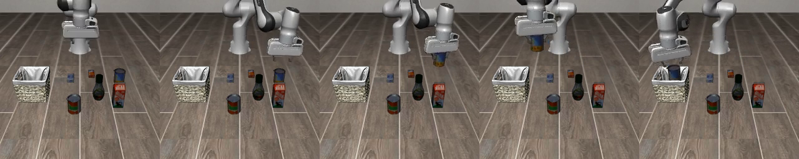

# LC-ACT

LC-ACT is a tabletop Franka Panda arm policy in MuJoCo LIBERO. This repository
is a **VLA research lab** for future [Starscream](https://github.com/gouthamk16/starscream) policies: same observe → chunk
→ act slot as the drone's `HoverPolicy`, different body. It is not the x500
and not the [Starscream](https://github.com/gouthamk16/starscream) flight stack.

GitHub: [gouthamk16/lc-act](https://github.com/gouthamk16/lc-act). In
[Starscream](https://github.com/gouthamk16/starscream) this repo is the `vla/` git submodule.

https://github.com/user-attachments/assets/625e6b4f-1673-4be4-ab51-8bfe6b167ec2

*The all-40-task policy driven from the web console (`python -m lc_act.live`):
type or pick an instruction, and the matching LIBERO scene runs closed loop.*



*Closed-loop LIBERO-Object rollout: reach, grasp, carry, and release into the
basket (frames left to right).*

## The observe-to-act loop

The model has the same three boxes as any small vision-language-action (VLA)
policy:

1. **Vision**: workspace and wrist images are resized to 128×128 and encoded by
   a shared, trainable ResNet-18 cut after layer3 into an 8×8 grid of tokens
   per camera. Each token gets an ACT-style 2-D sinusoidal position embedding,
   a learned camera id (workspace vs wrist), and FiLM modulation from the
   instruction.
2. **Language**: frozen CLIP text turns the instruction into one language
   token (plus a learned type tag). Embeddings are cached per instruction
   string.
3. **Action**: a small transformer (width 256, 3 encoder and 2 decoder layers)
   combines those tokens with the 8-D robot state (plus a type tag) and
   predicts a 16-step chunk of relative 7-D pose/gripper actions.

The closed loop is **observe → predict a 16-step chunk → execute one action →
observe again**. The policy replans every env step and executes the ACT
temporal ensemble of every chunk that covers that step. One dataset row is one
env control step; the dataset's 10 fps is a metadata label only.

Training uses all 40 tasks of the four standard LIBERO suites (Spatial,
Object, Goal, Long) and gives the model the previous frame and state as well
(`--n-obs 2`). During training only, the encoder also learns to predict frozen
DINOv2 features of the current frame and of the frame one chunk ahead; those
heads are dropped at inference. Evaluation (`lc_act.bench`) runs every task of
all four suites, the protocol MINERVA and π₀.₅ report.

The model is 7.7M parameters at inference.

More about the model architecture in [MODEL.md](MODEL.md).

## Install

CUDA wheels first, then the rest. From **this repository root** (standalone
clone of `lc-act`, or `cd vla` inside [Starscream](https://github.com/gouthamk16/starscream)):

```bash
python3 -m venv .venv
source .venv/bin/activate
pip install torch torchvision --index-url https://download.pytorch.org/whl/cu128
pip install -r requirements.txt
pip install -e .
```

`av` in `requirements.txt` is the PyAV video backend used by LeRobot.

[Starscream](https://github.com/gouthamk16/starscream) checkout:

```bash
git clone --recurse-submodules https://github.com/gouthamk16/starscream.git
cd starscream/vla
```

If you already cloned [Starscream](https://github.com/gouthamk16/starscream) without submodules:

```bash
git submodule update --init vla
```

## Run

Build the frame cache once (~25 min: decodes the AV1 videos to 128 px, then
packs them as q95 JPEG, ~30 GB of scratch on disk and 3.6 GB kept), then the
frozen DINOv2 targets (~15 min, 420 MB):

```bash
python -m lc_act.cache
python -m lc_act.teacher
```

Long train. The cosine learning rate schedule spans the `--max-hours`
deadline, or `--epochs` when there is none:

```bash
python -u -m lc_act.train --out outputs/lc_act_all40 --max-hours 4 --epochs 999 --save-every 2000
```

`--object-only` restricts training to the ten Object tasks.

Resume after a stop or crash (pass the same `--n-obs` the checkpoint was
trained with):

```bash
python -m lc_act.train --resume outputs/lc_act/last.pt --out outputs/lc_act --epochs 20 --max-hours 0
```

`--max-hours 2` is still the default if you omit the flag. `--max-hours 0`
means no deadline. Training reads the frame cache with 6 loader workers at
batch 64 (~830 samples/s, 1.7 GB VRAM). If RAM runs out, lower `--workers`.

Benchmark every task of the four suites (init states 0..N-1 per task, as
MINERVA reports with N = 50). Each LIBERO env holds ~2.9 GB of RAM, so keep
`--envs 2` on a 10 GB WSL box and do not run it next to training:

```bash
python -m lc_act.bench --ckpt outputs/lc_act_all40/last.pt --episodes 20 --out outputs/lc_act_all40/bench.json
```

`--ensemble uncertainty` weights each chunk's vote by its predicted Laplace
scale instead of age alone.

The older single-task eval runs ten fixed-seed soup episodes and saves episode zero:

```bash
python -m lc_act.eval \
  --ckpt outputs/lc_act/last.pt \
  --episodes 10 \
  --seed 0 \
  --video outputs/lc_act/soup_ep0.mp4
```

The original done bar was at least 2/10 successful soup episodes plus a
playable `outputs/lc_act/soup_ep0.mp4`; the current weights clear it.

Watch the trained policy in a browser. This loads `outputs/lc_act_all40/last.pt`
and streams the simulator cameras (rendered on the GPU under WSL2). The page
lists all 40 tasks by suite with each one's benchmark success rate. A typed
sentence is passed to the policy as written; the scene loads from the trained
task that shares the most words with it. Stop the benchmark first: each LIBERO
env holds ~2.9 GB of RAM.

```bash
python -m lc_act.live
```

Then open http://127.0.0.1:8765.

## Mapping to [Starscream](https://github.com/gouthamk16/starscream)

The tabletop mapping is the same policy slot used later by the drone:

```text
LcAct → pose deltas → Panda
HoverPolicy → TrajectorySetpoint → PX4
```

The body and simulator differ; this README does not add a drone or PX4
integration.

## Results

Current weights: `outputs/lc_act_film40/last.pt` — language FiLM in every
ResNet stage, two adjacent frames, DINOv2 alignment, **40 minutes** of
training (on the 90% autoresearch split). Benchmarked with `lc_act.bench`:
every task of the four suites, init states 0–19 (800 rollouts), LeRobot step
caps, replan every step with temporal ensembling.

| Suite | LC-ACT 8.0M (20 per task) | MINERVA-9.66M (50 per task) | π₀.₅ via LeRobot |
| --- | --- | --- | --- |
| Spatial | 97.5% | 98.4% | 97.0% |
| Object | 92.0% | 99.0% | 99.0% |
| Goal | **99.0%** | 98.4% | 98.0% |
| Long | 88.5% | 94.0% | 96.0% |
| **Average** | **94.25%** | 97.45% | 97.5% |

Goal now beats MINERVA; the average is 3.2 points behind it. **Caveat:**
closed-loop success varies a lot between training runs. The same
configuration trained 40 minutes on all the data scored 89.75% (Long 70.5%),
and 80 minutes scored 86.88%, so 94.25% is likely a good draw rather than the
configuration's typical result. A seed replicate is the next measurement. Object loses
most to one task, tomato sauce (40%, likely confused with the bbq sauce and
ketchup bottles), and Long to the mug and microwave tasks (80–85%).

Longer training made things worse. The same configuration trained for 4.5
hours scored 89.25% (Spatial 88.5, Object 91.0): per-stage language FiLM
overfits with long training even though it fixes the Goal and Long failures
early. The earlier 4-hour model without it (`outputs/lc_act_all40`, Sept 26)
scored 91.75%.

**Follow-up run (2026-10-12).** Language FiLM in every ResNet stage plus
history frames 8 steps apart, 4.5 hours (`outputs/lc_act_oct11/last.pt`):
Spatial 92.5, Object 95.5, Goal 93.0, Long 84.5, average **91.38%** — a tie
overall, but it fixed the targeted failures (both moka pots 25 → 55%, top
drawer 55 → 80%, middle drawer 75 → 95%) while breaking four tasks that used
to work (Spatial 5 90 → 65%, Object 1 100 → 85%). Uncertainty-weighted
ensembling on that model scored 89.38%, worse than plain decay ensembling
(paired 24 wins to 40 losses, nearly all on Long), so the default stays decay.
The next phase keeps changes on closed-loop panel success instead of val L1;
see `program.md`.

The autoresearch log is `artifacts/results.tsv`; per-task rates are in
`outputs/lc_act_all40/bench20_decay.json`.

The earlier Object-only model (`outputs/lc_act/last.pt`, commit `be73e88`)
scored 95% on the ten Object tasks, measured without a step cap.

History:

- 2026-09-14: the first model (28.5M trainable, 3 epochs) scored 0/10 soup.
- 2026-09-23: that 0/10, and later 0/10 results, came from an eval bug. The
  eval executed every action twice, but one dataset row is one env step. With
  one step per action, the 3-epoch five-encoder/three-decoder checkpoint scores
  10/10 soup (2/10 with the old repeat, same checkpoint and seeds).
- 2026-09-24: an autoresearch pass shrank the model to 7.6M trainable
  parameters (128 px, 256-wide transformer) while raising all-task success from
  62% to 86% open-loop, and 95% with temporal ensembling.
- 2026-10-12: language FiLM in every ResNet stage, chosen by a closed-loop
  panel instead of val L1, and trained 40 minutes instead of hours: 94.25%.
  History frames 8 steps apart had won val L1 by the widest margin of the
  loop and cost closed-loop success (panel 48 vs 56 of 60).
- 2026-09-27: all 40 tasks from a JPEG frame cache (830 vs 220 samples/s),
  two-frame history, batch 64, and training-only alignment to frozen DINOv2
  features of the current frame and the frame one chunk ahead. 91.75% over the
  four suites (800 rollouts).
