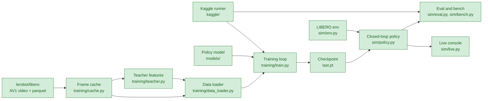

# LC-ACT engineering design

<!-- ste-allow: engineering, training, ensembling, matching, sampling, padding, string, rendering, embedding, learning, scaling, weighting, Hugging, pudding -->

| Field | Value |
|---|---|
| Status | Active. It changes with each feature commit. The code is a research lab, not a product. |
| Last change | 2026-11-21, `bf8ef99` |
| Language standard | ASD-STE100 (Simplified Technical English) |
| Code | `lc_act/` at the commit of this file |

This document gives the design of LC-ACT. It tells you what each component does, why it has its current design, and how the tests verify it. Each commit that adds or changes a feature also changes this document (refer to [section 10](#10-maintenance)).

Read sections 1 to 4 for an overview. Read section 5 for the design of one component. Sections 8 and 9 give the history of decisions and changes.

## Contents

1. [Purpose and scope](#1-purpose-and-scope)
2. [Terms](#2-terms)
3. [Requirements](#3-requirements)
4. [System overview](#4-system-overview)
5. [Component design](#5-component-design)
6. [Hard problems](#6-hard-problems)
7. [Open questions](#7-open-questions)
8. [Decision log](#8-decision-log)
9. [Change log](#9-change-log)
10. [Maintenance](#10-maintenance)

## 1. Purpose and scope

LC-ACT is a small language-conditioned policy for the Franka Panda arm in LIBERO, a MuJoCo benchmark. It reads two camera images, the robot state and an instruction. It predicts a chunk of 16 relative pose and gripper actions. The policy has 8.0M parameters at inference. The repository is a VLA research lab for the policy slot of [Starscream](https://github.com/gouthamk16/starscream).

The target is MINERVA-9.66M, which scores 97.45% over the four standard LIBERO suites. The current best result is a 4-model ensemble at 97.15% on the same protocol (2,000 rollouts). The project does this on one 8 GB laptop GPU and on Kaggle T4s, with no large vision-language model.

**In scope for the current version:**

- Training on all 40 tasks of LIBERO-Spatial, Object, Goal and Long, from a pre-decoded frame cache.
- A closed-loop benchmark of every task at LeRobot step caps, with chunk ensembles of several checkpoints.
- A local web console that runs the policy on typed instructions.
- Kaggle kernels that train and benchmark two experiments on two T4 GPUs.

**Out of scope for the current version:**

- Drone flight, PX4 or any Starscream flight-stack integration.
- Large VLA models (OpenVLA-OFT 7B, SmolVLA) and generalization at their level.
- A termination signal. The policy does not predict when a task is done.
- Real robots.

**Sources:** The recipe combines these works. Section 8 gives the result of each choice.

- Zhao et al., ACT, 2023: action chunks, learned queries, the temporal ensemble, the 2-D sine embedding.
- Kim et al., OpenVLA-OFT, 2025: parallel decode, chunks and an L1 loss on LIBERO.
- Liu et al., LIBERO, 2023: the benchmark and the ResNet-T language policy.
- Sendai et al., MINERVA: How Small Can a Manipulation Policy Be and Still Solve LIBERO?, arXiv:2609.03715, 2026: the small-policy target and its findings.
- "Think Like a World Model, Act Like a VLA", arXiv:2609.24682, 2026: cached teacher features with a cosine loss.
- Oquab et al., DINOv2, 2023. Yu et al., REPA (representation alignment), 2024.
- Wen et al., TinyVLA, RA-L 2025: a different model. Only the name is similar.

## 2. Terms

Each term has only one definition in this document.

| Term | Definition |
|---|---|
| LIBERO | A MuJoCo benchmark of tabletop tasks for a Franka Panda arm. LC-ACT uses it through the LeRobot `LiberoEnv` wrapper. |
| Suite | One of the four LIBERO task groups: `libero_spatial`, `libero_object`, `libero_goal` and `libero_10` (Long). Each suite has 10 tasks. |
| Task | One instruction and its scene, for example "put the bowl on the plate". The dataset task index is 0 to 39. |
| Episode | One demonstration or one rollout of one task. |
| Init state | A fixed start state of a task. Rollout k of a task starts from init state k. |
| Row | One step of one episode in the dataset. One row is one env control step. |
| Env step | One action that the env executes. LIBERO runs 20 env steps per second. |
| Optimizer step | One update of the weights from one batch. |
| Frame | The workspace image, the wrist image and the 8-D state of one step. |
| Chunk | The 16 actions that the model predicts from one frame history. Each action has 7 values. |
| H | The number of actions in a chunk. H is 16 (`HORIZON`). |
| History | The frames that the model sees for one prediction, oldest first. |
| `n_obs` | The number of frames in a history. The default is 2. |
| `obs_stride` | The gap in env steps between two frames of a history. The default is 1. |
| Temporal ensemble | The weighted mean of all actions that earlier chunks predicted for the current step (ACT). |
| Decay | The weight factor of the temporal ensemble. The vote at position i, oldest first, gets the weight exp(-decay × i). Thus older votes weigh more. |
| Stage FiLM | A scale and shift per channel, made from the language token, on the output of each ResNet stage. |
| Teacher features | Frozen DINOv2-small features of each cached frame. Training aligns the encoder to them. |
| Frame cache | The 128 px JPEG copy of all dataset frames, plus state, action and index arrays, on local disk. |
| Holdout | The last 10% of the episodes of each task. Fixed-budget runs keep them out of training. |
| Fixed budget | A run length that `--budget-seconds` or `--budget-steps` sets. |
| Val L1 | The mean absolute action error on the holdout, in z-score units. |
| Raw L1 | The val L1 in env units, after the stats are removed. |
| Grip | The fraction of holdout gripper actions that have the correct sign. |
| Bench | The closed-loop benchmark in `lc_act.sim.bench`. |
| Panel | A small fixed set of tasks for a quick closed-loop check with `--tasks`. |
| Model ensemble | Several checkpoints of one configuration whose chunks the bench averages. |

## 3. Requirements

| Id | Requirement | Verification | Status |
|---|---|---|---|
| REQ-1 | A checkpoint holds the normalization stats. Eval refuses a checkpoint without them. | `test_payload_without_stats_is_refused` | Met |
| REQ-2 | A checkpoint from before a config field existed loads with the old value of that field (`n_obs` 1, `obs_stride` 1, decoder layers 2). | `test_payload_without_later_fields_gets_their_old_defaults` | Met |
| REQ-3 | A load fails if any trainable weight is absent. The frozen CLIP weights are never in a checkpoint. | `test_load_trainable_rejects_missing_camera_embed`, `test_trainable_state_dict_skips_text_keys` | Met |
| REQ-4 | No holdout episode is in the train set. Each task has holdout episodes. | `test_split_by_task_holds_out_last_episode_of_every_task`, `test_load_cached_holdout_keeps_val_out_of_train` | Met |
| REQ-5 | A history never crosses the start of its episode. A chunk never crosses the end of its episode. | `test_cached_sample_clamps_history_and_pads_chunk_within_episode`, `test_strided_history_reaches_back_and_clamps_at_episode_start` | Met |
| REQ-6 | Training with `--budget-steps N` stops after exactly N optimizer steps, across epochs. | `test_budget_steps_stops_at_that_step_across_epochs` | Met |
| REQ-7 | The seconds budget starts after the first batch, so startup time is not counted. | `test_budget_seconds_arms_after_the_first_batch` | Met |
| REQ-8 | Eval and bench replan at each env step and execute the temporal ensemble with decay 0.01. The first frame of an episode fills the history. | `policy_test.py` (7 tests) | Met |
| REQ-9 | The bench runs every task of each selected suite at init states `first_init` to `first_init + episodes - 1`, at the LeRobot step cap of each suite. | `test_default_covers_all_suites_from_init_zero`, `test_first_init_offsets_the_init_range_of_every_task` | Met for job selection. The step cap has no test. |
| REQ-10 | The members of a model ensemble have the same `n_obs`, the same `obs_stride` and the same normalization stats. | Planned: a test. `ModelEnsemble` and `load_policy` raise `ValueError`. | Met in the code |
| REQ-11 | The CLI flags keep their names across refactors, because the docs, program.md and Kaggle configs use them. | `test_cli_flags_keep_their_names`, `test_several_checkpoints_follow_one_flag` | Met |
| REQ-12 | Training fits in 8 GB of GPU memory at batch 64. | Measured once: 1.7 GB peak on an RTX 4060 Laptop (section 5.3). No automatic check. | Met |
| REQ-13 | One policy call fits a 20 Hz control loop. | Measured once: 7 ms per call (section 5.3). No automatic check. | Met |

## 4. System overview

LC-ACT is a pipeline: an offline cache step, a training step and a closed-loop rollout step that all share one model definition.



| Component | Module | Status | Section |
|---|---|---|---|
| Normalization | `lc_act/shared/normalize.py` | Implemented | [5.1](#51-normalization) |
| Encoders | `lc_act/models/vision.py`, `text.py`, `posenc.py` | Implemented | [5.2](#52-encoders) |
| Policy model | `lc_act/models/lc_act.py` | Implemented | [5.3](#53-policy-model) |
| Frame cache and teacher features | `lc_act/training/cache.py`, `teacher.py` | Implemented | [5.4](#54-frame-cache-and-teacher-features) |
| Data loader | `lc_act/training/data_loader.py` | Implemented | [5.5](#55-data-loader) |
| Checkpoints | `lc_act/training/checkpoints.py` | Implemented | [5.6](#56-checkpoints) |
| Training loop | `lc_act/training/train.py`, `config.py`, `validation.py` | Implemented | [5.7](#57-training-loop) |
| Closed-loop policy | `lc_act/sim/env.py`, `policy.py` | Implemented | [5.8](#58-closed-loop-policy) |
| Eval and bench | `lc_act/sim/eval.py`, `bench.py` | Implemented | [5.9](#59-eval-and-bench) |
| Live console | `lc_act/sim/live.py`, `live.html` | Implemented | [5.10](#510-live-console) |
| Kaggle runner | `kaggle/launch.py`, `kaggle/run_template.py` | Implemented | [5.11](#511-kaggle-runner) |

## 5. Component design

Each subsection has the same parts: function, interface, design, rationale, limits and verification.

### 5.1 Normalization

**Function:** `NormStats` holds the mean and standard deviation of the 8-D state and the 7-D action. It converts values to z-scores and back.

**Interface:**

```python
@dataclasses.dataclass
class NormStats:
    state_mean: torch.Tensor; state_std: torch.Tensor
    action_mean: torch.Tensor; action_std: torch.Tensor
    @classmethod
    def from_tensors(cls, state: torch.Tensor, action: torch.Tensor) -> NormStats
    @classmethod
    def from_dict(cls, data: dict[str, torch.Tensor]) -> NormStats
    def to_dict(self) -> dict[str, torch.Tensor]
    def to(self, device: torch.device) -> NormStats
    def normalize_state(self, state) -> torch.Tensor
    def normalize_action(self, action) -> torch.Tensor
    def unnormalize_action(self, action) -> torch.Tensor
```

**Design:**

- `from_tensors` takes the statistics over every dimension but the last. Thus it accepts states `(n, 8)` and chunks `(n, H, 7)`.
- The standard deviation has a floor of 1e-6, so a constant dimension stays finite.
- `to_dict` gives the four tensors on the CPU. The checkpoint payload stores this dict under the key `stats`.

**Rationale:**

- The stats come from the train rows only and go into each checkpoint, so eval uses the same scale as training.
- Members of a model ensemble act in one normalized space. Thus they must share stats (D-19).

**Limits:** The stats are not per suite. A model trained with `--object-only` has different stats from an all-task model and cannot join its ensemble.

**Verification:**

| Test | What it shows |
|---|---|
| `test_normalize_then_unnormalize_action_is_identity` | The two conversions are inverse to each other. |
| `test_std_is_clamped_away_from_zero` | A constant input gives a finite scale. |
| `test_dict_roundtrip_keeps_every_field` | The checkpoint form keeps all four tensors. |

### 5.2 Encoders

**Function:** `ResNetSpatial` turns camera frames into an 8×8 grid of 256-d tokens. `ClipTextEncoder` turns each instruction into one 512-d embedding. `sinusoidal_2d` gives the 2-D position embedding of the grid.

**Interface:**

```python
VISION_SIZE = 128
STAGE_CHANNELS = (64, 128, 256)
FEATURE_DIM = 256

class ResNetSpatial(nn.Module):
    def __init__(self, *, pretrained: bool = True) -> None
    def encode(self, images: torch.Tensor, film: list[torch.Tensor], group: int = 1) -> torch.Tensor

TEXT_DIM = 512
class ClipTextEncoder(nn.Module):
    def __init__(self, model_id: str = "openai/clip-vit-base-patch32") -> None
    def encode(self, texts: list[str]) -> torch.Tensor

def grid_hw(num_tokens: int) -> tuple[int, int]
def sinusoidal_2d(height, width, dim, device, dtype) -> torch.Tensor  # (1, height * width, dim)
```

**Design:** `ResNetSpatial.encode` does these steps:

1. It converts the images `(n, h, w, 3)` to float in [0, 1] and resizes them to 128 px.
2. In training, it shifts each image by up to 8 px. The `group` frames of one history get the same shift.
3. It applies the ImageNet normalization and the ResNet-18 stem.
4. After each of layer1, layer2 and layer3, it applies the stage FiLM: `feat * (1 + gamma) + beta`.
5. It gives the layer3 map as tokens `(n, 64, 256)`.

`ClipTextEncoder` keeps a dict from instruction to embedding. It runs CLIP only for instructions that are not in the dict.

**Rationale:**

- A spatial feature map keeps the grasp geometry. One CLIP vector per camera loses it (D-1).
- The ResNet stops after layer3. At 128 px this gives an 8×8 grid without the 8.4M parameters of layer4 (D-7).
- The stem runs in `channels_last` memory format: fp16 convolutions are 2.2× faster on Ada GPUs (D-8).
- Without the 2-D position embedding and the camera tags, the encoder is permutation-invariant. It cannot use the patch location or the camera of a token.
- CLIP is frozen. The dict cache avoids a CLIP call per sample, because LIBERO has only 40 instructions.

**Limits:**

- The token grid must be square. `grid_hw` raises `ValueError` for other counts.
- `_as_nchw_float` treats any batch with a maximum above 1.5 as 0–255 data.

**Verification:**

| Test | What it shows |
|---|---|
| `test_resnet_spatial_is_an_8x8_grid_at_128px` | A 256 px frame gives 64 tokens of 256 values. |
| `test_random_shift_uses_one_offset_per_frame_stack` | The frames of one history get the same shift. |
| `test_grid_hw_rejects_non_square_token_count` | A token count that is not a square is refused. |
| `test_sinusoidal_2d_differs_across_grid_cells` | Each grid cell gets a different embedding. |

### 5.3 Policy model

**Function:** `LcAct` maps two camera histories, a state history and an instruction to a chunk of H actions. It can also give a Laplace log-scale per action, and predicted teacher features for training.

**Interface:**

```python
STATE_DIM = 8; ACTION_DIM = 7; HORIZON = 16; TEACHER_DIM = 384

@dataclasses.dataclass(frozen=True)
class LcActConfig:
    width: int = 256; num_heads: int = 8; num_encoder_layers: int = 3
    num_decoder_layers: int = 2; ffn_dim: int = 1024; horizon: int = HORIZON
    n_obs: int = 1; obs_stride: int = 1
    history_size: int  # property: obs_stride * (n_obs - 1) + 1
    def create(self, *, pretrained: bool = True) -> LcAct

class LcAct(nn.Module):
    def __init__(self, config: LcActConfig, vision: Vision, text: TextEncoder) -> None
    def forward(self, workspace, wrist, state, tasks, *, with_scale=False) -> actions | (actions, log_scale)
    def encode(self, workspace, wrist, state, tasks) -> torch.Tensor   # (b, 130, width)
    def decode(self, memory, *, with_scale=False) -> actions | (actions, log_scale)
    def teacher_prediction(self, memory) -> torch.Tensor  # (b, 2 times, 2 cameras, 384)
```

**Design:** The encoder memory has 130 tokens:

| Tokens | Source | Tags |
|---|---|---|
| 0–63 | Workspace grid, FiLM from language | 2-D sine + camera 0 |
| 64–127 | Wrist grid, FiLM from language | 2-D sine + camera 1 |
| 128 | Language: CLIP embedding → linear | type 0 |
| 129 | State: `n_obs × 8` values → linear | type 1 |

1. The history frames of one camera go through the ResNet together. Each grid cell concatenates the `n_obs` feature vectors, then `vision_proj` maps them to the width. Thus the token count does not change with `n_obs`.
2. A 3-layer pre-norm encoder mixes the 130 tokens.
3. H learned queries cross-attend in a 2-layer pre-norm decoder.
4. `action_head` gives the chunk `(b, 16, 7)`. `scale_head` gives the log-scale from the detached decoder output.
5. `teacher_prediction` mean-pools the tokens of each camera. Two heads predict the teacher features of this frame and of the frame one chunk ahead.

```text
workspace RGB 256x256 --+  resize to 128x128 (train: +-8 px random shift)
                        +-- shared ResNet-18 through layer3 (trainable),
                        |   each stage FiLM'd by the language token
wrist RGB 256x256 ------+         |
                                  v
                         8x8 spatial tokens per camera (256-d)
                         + 2-D sinusoidal pos embed + learned camera id
                         + FiLM (gamma, beta) from the language token
instruction -- frozen CLIP text (cached per string) --> 1 language token + type tag
proprio 8-D -- linear --> 1 state token + type tag

concat -> encoder (d=256, 8 heads, 3 pre-norm layers, FFN 1024)
       -> 16 action queries, 2-layer decoder (cross-attend)
       -> linear -> (16, 7) relative pose + gripper     -> L1 vs z-scored demo chunk
       -> MLP on detached features -> (16, 7) log-scale -> Laplace NLL

training only:
  mean-pooled encoder tokens per camera -> 2 MLPs -> DINOv2-S features of this frame
                                                     and of the frame 15 steps ahead -> cosine
```

The parameter counts are:

| Part | Parameters | Trained |
|---|---|---|
| ResNet-18 through layer3 | 2,782,784 | Yes |
| Projections, tags, FiLM, transformer, action and scale heads | 5,179,534 | Yes |
| Teacher-alignment heads | 657,152 | Training only |
| CLIP text model | about 63M | Frozen |
| Total at inference, without CLIP | 7,962,318 | |

At batch 64 on an RTX 4060 Laptop (8 GB), training has a peak of 1.7 GB of GPU memory. One policy call takes 7 ms, which fits a 20 Hz control loop.

**Rationale:**

- Pre-norm layers: post-norm residuals made early training noisy on a short budget (D-4).
- Two frames per sample, fused per token, like MINERVA (D-14). Adjacent frames are the default (D-13).
- Stage FiLM: Goal tasks share one scene and differ only in the instruction (D-6). All FiLM layers start at zero, so the pretrained ResNet starts unmodulated (D-5).
- The scale head trains on detached features, so it never changes the actions (D-28).
- Teacher alignment costs 0.66M parameters in training and nothing at inference (D-15).
- `create` builds the vision, then the text, then the policy. Seeded runs depend on this order for the same initial weights.

**Limits:**

- The state dict keys and the creation order of the parameters are part of each saved checkpoint and of each seeded run. Do not rename or reorder them.
- H is fixed at 16 in the frame cache stats and in the data loader (D-16).
- The model has no termination output.
- LIBERO has only 40 short instructions, so the model can learn to ignore the language. Goal tasks and the cream-cheese task of Object are the check.

**Verification:**

| Test | What it shows |
|---|---|
| `test_forward_shape_is_batch_horizon_action` | One frame gives a `(b, 16, 7)` chunk. |
| `test_two_frame_history_forward_shape` | Two frames give a chunk and a log-scale of the same shape. |
| `test_history_size_reaches_the_oldest_strided_frame` | `n_obs` 2 with `obs_stride` 8 keeps 9 steps. |
| `test_teacher_prediction_is_two_times_two_cameras` | The alignment output has the teacher layout. |
| `test_workspace_and_wrist_tokens_differ_when_images_match` | The camera tag separates the two cameras. |

### 5.4 Frame cache and teacher features

**Function:** `python -m lc_act.training.cache` decodes `lerobot/libero` once into a 128 px JPEG frame cache. `python -m lc_act.training.teacher` writes the teacher features of every cached frame to `teacher.npy`.

**Interface:**

```python
def build(repo_id: str, out: pathlib.Path, workers: int) -> None
def pack(root: pathlib.Path, quality: int = 95, batch: int = 1024) -> None
def snapshot_dir(repo_id: str = "lerobot/libero") -> pathlib.Path
def resize_uint8(frames: torch.Tensor) -> torch.Tensor  # (n, h, w, 3) -> (n, 128, 128, 3)
# CLI: --repo-id, --out, --workers, --pack-only / teacher CLI: --cache, --batch
```

**Design:** The cache directory holds these files:

| File | Content |
|---|---|
| `state.npy`, `action.npy` | Per-row state `(rows, 8)` and action `(rows, 7)`, float32, in dataset order. |
| `episode_index.npy`, `task_index.npy`, `frame_index.npy` | Per-row indices, int64. |
| `tasks.json` | The 40 instructions, by task index. |
| `workspace.jpg.bin`, `wrist.jpg.bin` + `.offsets.npy` | q95 JPEG frames and their byte offsets. |
| `workspace.u8`, `wrist.u8` | The raw uint8 frames (27 GB). Training does not read them. |
| `teacher.npy` | `(rows, 2 cameras, 384)` float16 teacher features. |
| `meta.json` | The row count. Its presence marks a complete cache. |

1. `build` writes the tables from the dataset parquet files.
2. A spawned process pool decodes each video file and resizes the frames on the GPU with the model filter.
3. `pack` encodes the raw frames as q95 JPEG.
4. `teacher` upsamples each 128 px frame to 224 px and mean-pools the DINOv2 patch tokens.

The dataset has 1,693 episodes and 273k frames over the 40 tasks. Task indices 0–9 are Long, 10–19 Goal, 20–29 Object and 30–39 Spatial. The JPEG pack is 3.6 GB.

**Rationale:**

- A JPEG decode is faster than a video seek: 830 versus 220 samples/s (D-9).
- The JPEG pack is about 3.5 GB and stays in the page cache. The raw memmap does not (D-9).
- The resize uses the same filter as the model at eval, so train and eval see the same pixels. It is bit-exact against the LeRobot decoder.
- The teacher reads the 128 px cache, so the teacher and the student see the same pixels.

**Limits:**

- The cache needs the dataset in the Hugging Face cache first.
- q95 differs from the raw frames by about 1/255 on average.
- The layout of the cache is frozen by program.md. A change invalidates all comparisons of val L1.

**Verification:**

| Test | What it shows |
|---|---|
| `test_cached_sample_clamps_history_and_pads_chunk_within_episode` | `pack` writes frames that the data loader decodes back to the correct rows (with the data loader). |

### 5.5 Data loader

**Function:** `load_cached` gives the train set, the optional holdout set, the train stats and the task strings. `CachedLibero` gives one `Sample` per row.

**Interface:**

```python
DEFAULT_ROOT = pathlib.Path.home() / ".cache/lc_act/libero128"
CAMERAS = {"workspace": "observation.images.image", "wrist": "observation.images.image2"}
SUITES = {"libero_10": range(0, 10), "libero_goal": range(10, 20),
          "libero_object": range(20, 30), "libero_spatial": range(30, 40)}
def suite_of(task_index: int) -> str

@dataclasses.dataclass
class Sample: workspace; wrist; state; action; task: str; teacher: torch.Tensor | None
@dataclasses.dataclass
class Batch:  workspace; wrist; state; action; tasks: list[str]; teacher | None
    def to(self, device: torch.device) -> Batch
def collate(samples: list[Sample]) -> Batch

class CachedLibero(torch.utils.data.Dataset):
    def __init__(self, root, rows, stats, tasks, *, n_obs=1, obs_stride=1, horizon=HORIZON, teacher=False)
def load_cached(root=DEFAULT_ROOT, *, object_only=False, n_obs=1, obs_stride=1, holdout=False, teacher=False)
def episode_bounds(episode: np.ndarray) -> tuple[np.ndarray, np.ndarray]
def split_by_task(episode, task, val_frac=0.1) -> tuple[np.ndarray, np.ndarray]
```

**Design:** For row r of an episode with first row `first` and last row `last`:

- The history rows are `max(r + obs_stride × k, first)` for k = -(n_obs - 1) to 0.
- The chunk rows are `min(r + i, last)` for i = 0 to H - 1. A chunk near the end repeats the last action.
- The teacher target holds the features of row r and of the last chunk row.

**Example:** An episode of 3 rows starts at row 3. With `n_obs` 2, row 3 has the history rows `[3, 3]`. Row 5 has `[4, 5]`. With H 4, row 5 has the chunk rows `[5, 5, 5, 5]`.

`load_cached` holds out the last 10% of the episodes of each task (at least one). The val set takes every 8th holdout row. The stats come from the train rows and their full chunks.

**Rationale:**

- A per-task holdout puts every suite in val (D-23).
- Every 8th holdout row covers all val episodes at a lower cost.
- Each loader worker opens the JPEG memmap itself, after the fork.

**Limits:**

- The rows of one episode must be contiguous. `episode_bounds` depends on it.
- The suite ranges in `SUITES` follow the task order of `lerobot/libero`. Do not change them.

**Verification:**

| Test | What it shows |
|---|---|
| `test_episode_bounds_per_row` | Each row gets the first and last row of its episode. |
| `test_split_by_task_holds_out_last_episode_of_every_task` | Each task loses its last episodes to val. |
| `test_cached_sample_clamps_history_and_pads_chunk_within_episode` | The worked example above, with real frames. |
| `test_strided_history_reaches_back_and_clamps_at_episode_start` | `obs_stride` 8 reaches back 8 rows and stops at the episode start. |
| `test_load_cached_holdout_keeps_val_out_of_train` | No val row is a train row. |
| `test_suite_of_matches_dataset_task_order` | Task 0 is Long, 24 is Object, 39 is Spatial. |
| `test_collate_stacks_samples_and_keeps_task_order` | The batch keeps the order of the samples. |

### 5.6 Checkpoints

**Function:** This component saves a training run to `last.pt` and rebuilds a model and its stats from it.

**Interface:**

```python
@dataclasses.dataclass
class Checkpoint:
    trainable: dict[str, torch.Tensor]; stats: NormStats; horizon: int; tasks: list[str]
    epoch: int = 0; step: int = 0; optimizer: dict | None = None; scaler: dict | None = None
    n_obs: int = 1; obs_stride: int = 1; n_decoder_layers: int = 2
    def model_config(self) -> LcActConfig
    def to_payload(self) -> dict[str, Any]
    @classmethod
    def from_payload(cls, payload: dict[str, Any]) -> Checkpoint

def trainable_state_dict(model: LcAct) -> dict[str, torch.Tensor]
def load_trainable(model: LcAct, state_dict) -> LcAct
def save_checkpoint(path, model, stats, tasks, *, epoch, step, optimizer, scaler) -> None
def read_checkpoint(path: pathlib.Path) -> Checkpoint
def restore(checkpoint: Checkpoint, device) -> tuple[LcAct, NormStats]
def load_checkpoint(path: pathlib.Path, device) -> tuple[LcAct, NormStats]
```

**Design:**

- The payload is a plain dict with the field names of `Checkpoint`. The stats are a dict of four CPU tensors.
- `trainable_state_dict` drops every key that starts with `text.` (the frozen CLIP model).
- `save_checkpoint` writes to `last.pt.tmp` and then renames it.
- `restore` builds the model with `pretrained=False`. The ResNet weights come from the checkpoint.

**Rationale:**

- The atomic rename keeps the previous checkpoint if a run stops during a save.
- The defaults for absent fields are the values that the older runs used. The field `n_decoder_layers` came in `85e8f5a`, and older checkpoints all had two decoder layers.

**Limits:**

- The payload format is frozen: the four ensemble checkpoints of the best result use it.
- `outputs/lc_act/last.pt` and `outputs/lc_act_all40/last.pt` do not load. They have no stage FiLM weights (refer to section 7).
- `torch.load` runs with `weights_only=False`. Load only checkpoints that you trust.

**Verification:**

| Test | What it shows |
|---|---|
| `test_payload_roundtrip_keeps_epoch_step_optimizer` | A resume gets the epoch, the step and the optimizer state back. |
| `test_payload_without_later_fields_gets_their_old_defaults` | REQ-2. |
| `test_payload_without_stats_is_refused` | REQ-1. |
| `test_load_trainable_rejects_missing_camera_embed` | REQ-3, for an absent trainable key. |
| `test_trainable_state_dict_skips_text_keys` | REQ-3, for the frozen CLIP weights. |

### 5.7 Training loop

**Function:** `python -m lc_act.training.train` trains a model on the frame cache and writes `config.out/last.pt`. A fixed-budget run also prints one val line.

**Interface:**

```python
@dataclasses.dataclass(frozen=True)
class TrainConfig:  # tyro CLI: --out --resume --cache --seed --workers --epochs --max-hours
                    # --save-every --budget-seconds --budget-steps --val-batches --batch-size
                    # --object-only --n-obs --obs-stride --long-weight --lr --warmup-frac --align-weight
    fixed_budget: bool  # property
    def model_config(self) -> LcActConfig

def lr_scale(progress: float, warmup_frac: float) -> float
def train_step(model, batch, optimizer, scaler, align_weight: float) -> float
def train_loop(config, model, loader, stats, tasks, device, *, val_loader=None, resume=None) -> None
def main(config: TrainConfig) -> None

@dataclasses.dataclass(frozen=True)
class ValMetrics: l1: float; raw_l1: float; grip_acc: float; per_suite: dict[str, float]
def evaluate_val(model, loader, device, max_batches, stats, suite_of_task=None) -> ValMetrics
```

**Design:** The loss of one step is the sum of three terms:

| Term | Value | Trains |
|---|---|---|
| Action L1 | mean of `abs(prediction - action)` | All but the scale head |
| Laplace NLL | `mean(error.detach() * exp(-log_scale) + log_scale)` | The scale head only |
| Alignment | `align_weight × mean(1 - cosine(prediction, teacher))` | The encoder and the alignment heads |

1. `main` seeds torch, loads the cache, builds the loaders and builds or restores the model.
2. Before each step, `train_epoch` sets the learning rate from `lr_scale(progress)`.
3. `progress` comes from the first of these that is set: the step budget, the seconds budget, the deadline, the epochs.
4. `lr_scale` warms up linearly over 2% of the run, then decays with a cosine to zero.
5. A run without a fixed budget saves at each `save_every` step and at each epoch end.
6. A fixed-budget run evaluates the holdout once and saves once at the end.

The val line has a fixed format, because the autoresearch loop reads it with `grep " | val "`:

```text
Step 200 : train 0.6547 | val 0.4847 | raw 0.1383 | grip 0.877 | gpu 1.79GB
suites: libero_10 0.4952 | libero_goal 0.5734 | libero_object 0.3538 | libero_spatial 0.5283
```

**Rationale:**

- AdamW with batch 64 and peak learning rate 1.2e-3 follows square-root scaling from the earlier batch (D-30).
- `--budget-steps` fixes the run length in optimizer steps, so runs compare across machines (D-18).
- The default run length is short. Longer runs overfit the stage FiLM (D-17).
- Fixed-budget runs use the holdout. The long runs train on all data.
- The former module constants are `TrainConfig` fields, so Kaggle overrides are plain flags (D-27).

**Limits:**

- CPU runs are 1-step smoke tests. `main` refuses CPU runs with more than one epoch.
- SIGINT and SIGTERM stop the run after the current step and save it.
- A resume must use the `n_obs` and `obs_stride` of the checkpoint. `main` raises `RuntimeError` otherwise.
- The data loader of a resumed run normalizes with fresh stats from the cache. The model keeps the stats of the checkpoint.

**Verification:**

| Test | What it shows |
|---|---|
| `test_budget_steps_stops_at_that_step_across_epochs` | REQ-6. |
| `test_budget_seconds_arms_after_the_first_batch` | REQ-7. |
| `test_max_hours_zero_means_no_deadline` | `--max-hours 0` disables the deadline. |
| `test_lr_warms_up_then_decays_to_zero` | The schedule at four points. |
| `test_cli_flags_keep_their_names` | REQ-11. |
| `test_evaluate_val_is_mean_l1` | Val L1 is the mean absolute error. |
| `test_evaluate_val_raw_l1_uses_action_std` | Raw L1 is in env units. |
| `test_evaluate_val_grip_acc_is_sign_match_in_raw_units` | Grip compares signs in env units, with a dead zone of 0.05. |
| `test_evaluate_val_breaks_down_by_suite` | The per-suite line groups rows by suite. |

### 5.8 Closed-loop policy

**Function:** `sim/env.py` makes LIBERO envs and converts each observation to a frame. `sim/policy.py` turns model chunks into one action per env step.

**Interface:**

```python
ENV_FPS = 20; ENV_RESOLUTION = 256
def configure_gl() -> None
def benchmark_dict() -> dict[str, Any]
def make_env(task_id: int = 0, suite_name: str = "libero_object") -> Any
def max_steps(env) -> int
def observe(obs) -> tuple[np.ndarray, np.ndarray, np.ndarray]  # workspace, wrist, state
def pack_state(obs) -> np.ndarray  # (8,) float32
def quat_to_axis_angle(quat) -> np.ndarray

ENSEMBLE_DECAY = 0.01
class ChunkEnsembler:
    def __init__(self, config: LcActConfig, decay: float = ENSEMBLE_DECAY) -> None
    def observe(self, frame) -> tuple[torch.Tensor, torch.Tensor, torch.Tensor]  # (n_obs, ...)
    def act(self, chunk: torch.Tensor, log_scale: torch.Tensor | None = None) -> torch.Tensor
class ModelEnsemble(nn.Module): ...
def temporal_ensemble(candidates, decay, log_scales=None) -> torch.Tensor
def to_tensors(frame, stats, device) -> tuple[torch.Tensor, torch.Tensor, torch.Tensor]
```

**Design:** At each env step:

1. `observe` rotates both 256 px images by 180 degrees and packs the state.
2. `ChunkEnsembler.observe` adds the frame to the history. The first frame of an episode fills the whole history.
3. The model predicts a chunk from the `n_obs` frames.
4. `act` adds the chunk as one vote for each of the next 16 steps.
5. `act` returns the temporal ensemble of all votes for the current step.

**Example:** With decay 0, the step gets votes 0.0 and 1.0 from two chunks. `act` returns 0.5. With decay 0.5, an old vote of 1.0 and a new vote of 0.0 give 1 / (1 + e^-0.5) ≈ 0.62.

**Rationale:**

- Replan at each step with the ACT temporal ensemble: MINERVA found that it beats long open-loop chunks (D-10).
- One action per env step, because one dataset row is one control step (D-11).
- Decay ensembling is the default. Uncertainty weighting lost closed loop (D-12).
- Under WSL2, `configure_gl` selects GLFW with the Mesa D3D12 driver, because EGL falls back to llvmpipe at about 42 ms per camera (D-20).
- `ChunkEnsembler` holds the protocol in one place for eval, bench and the console.

**Limits:**

- `configure_gl` must run before the first import of MuJoCo. `benchmark_dict` and `make_env` call it first.
- `max_steps` reads a private attribute of `LiberoEnv`, because the wrapper has no public step cap.
- The temporal ensemble arithmetic is frozen by program.md.

**Verification:**

| Test | What it shows |
|---|---|
| `test_temporal_ensemble_weights_oldest_prediction_most` | The decay example above. |
| `test_temporal_ensemble_downweights_unsure_candidate_per_dim` | A large log-scale lowers a vote in that dimension only. |
| `test_first_frame_fills_the_history_then_frames_shift_in` | REQ-8, for the history. |
| `test_act_ensembles_every_chunk_covering_the_step` | REQ-8, for the votes. |
| `test_observe_packs_8d_state_and_flips_both_cameras` | The frame layout matches the dataset. |
| `test_flip_hw_rotates_180` | The rotation of an image. |

### 5.9 Eval and bench

**Function:** `python -m lc_act.sim.eval` runs episodes of one Object task and writes a video. `python -m lc_act.sim.bench` runs the closed-loop benchmark and writes a summary JSON.

**Interface:**

```python
# eval CLI: --ckpt --episodes --seed --video
def run_episode(model, stats, env, device, seed, *, task=TASK, on_frame=None, stop=None) -> bool

# bench CLI: --ckpt A [B ...] --suites --tasks --episodes --first-init --envs --ensemble {decay,uncertainty} --out
@dataclasses.dataclass(frozen=True)
class Job: suite: str; task_id: int; init: int
def load_policy(paths, device) -> tuple[nn.Module, NormStats]
def pick_jobs(args: Args) -> list[Job]
def run_benchmark(model, stats, jobs, n_envs, device, *, uncertainty=False, log=print) -> dict[Job, tuple[bool, int]]
def summarize(results) -> dict  # {"suites", "average", "tasks", "episodes"}
```

**Design:**

1. `load_policy` loads each checkpoint. With more than one, it shares one CLIP model and wraps the members in `ModelEnsemble`.
2. `pick_jobs` makes one job per task and init state.
3. `run_benchmark` starts `--envs` spawned worker processes. Each worker owns one LIBERO env.
4. Whole tasks go to the workers in turn. A worker builds a new env only when the task changes.
5. At each step, one batched forward pass serves all active envs.
6. An episode ends at success, at env termination or at the step cap of its suite.

**Rationale:**

- Whole tasks in turn spread the long Long tasks over all workers (D-21).
- Two envs by default: each env holds about 2.9 GB, and the laptop has 10 GB of RAM (D-22).
- Model ensembles average chunks of several seeds (D-19).
- `--first-init` lets two GPUs split a 50-init bench.

**Limits:**

- The Long tasks are not reproducible step for step between two runs of the same code (refer to section 7).
- The bench needs about 2.9 GB of RAM per env.
- The step caps come from LeRobot: Spatial 280, Object 280, Goal 300, Long 520.
- The 95% Object result of `be73e88` came from `lc_act.sim.eval` before it had a step cap. It does not compare with bench numbers.

**Verification:**

| Test | What it shows |
|---|---|
| `test_default_covers_all_suites_from_init_zero` | REQ-9, for the default job list. |
| `test_first_init_offsets_the_init_range_of_every_task` | REQ-9, for `--first-init`. |
| `test_several_checkpoints_follow_one_flag` | `--ckpt` takes several paths. |
| `test_deal_keeps_each_task_on_one_worker` | All init states of one task go to one worker. |
| `test_summarize_averages_suites` | The average is the mean of the suite rates. |

### 5.10 Live console

**Function:** `python -m lc_act.sim.live` serves a local web page. The page streams the two cameras of a LIBERO rollout and takes instructions.

**Interface:**

```text
GET  /         the page (live.html)
GET  /tasks    {"suites": [{"label", "success", "tasks": [{"text", "success"}]}]}
GET  /status   {"message": str}
GET  /stream   multipart/x-mixed-replace JPEG stream
POST /prompt   {"text": str} -> 200 {"message"} or 400 {"message"}
POST /reset    -> 200 {"message"}
```

```python
def resolve_prompt(query: str, tasks: Sequence[str]) -> tuple[str, str]  # (scene task, spoken text)
class Console: start, publish, wait_frame, submit, reset_scene, suites
```

**Design:**

1. `resolve_prompt` finds the trained task with the most shared words. Filler words do not count.
2. If two tasks share the same score, it rejects the instruction.
3. The scene comes from the matched task. The policy gets the exact text of the user.
4. A background thread owns the model and one env. The HTTP handler only queues requests.
5. A new request cancels the current episode.

**Rationale:** The console shows how the policy reacts to words that it was not trained on. The scene must still match a trained task, because the policy needs a known scene.

**Limits:** The console runs one episode at a time. It resets each episode with seed 0.

**Verification:**

| Test | What it shows |
|---|---|
| `test_resolve_prompt_passes_a_paraphrase_through` | A paraphrase gets the scene of its task and keeps its own words. |
| `test_resolve_prompt_prefers_the_task_its_words_cover` | The covered fraction breaks ties between tasks. |
| `test_resolve_prompt_rejects_two_sauces` | An instruction that fits two tasks is refused. |
| `test_resolve_prompt_rejects_text_with_no_task_words` | An instruction with no task words is refused. |

### 5.11 Kaggle runner

**Function:** `kaggle/launch.py` writes a Kaggle kernel from `kaggle/run_template.py` and pushes it. The kernel trains up to two experiments in parallel, one per T4, then benchmarks each.

**Interface:**

```text
python kaggle/launch.py <slug> '<config json>' [kernel_source ...]
config: {"experiments": [{"tag", "overrides", "args", "episodes", "envs", "first_init", "ckpts"}]}
```

**Design:**

1. `setup` installs the pinned packages and rebuilds `lc_act/` from the `lc-act-code` dataset.
2. `pipeline` makes one shell chain per experiment: train, then bench.
3. Each key of `overrides` becomes a `TrainConfig` flag. A boolean becomes `--x` or `--no-x`.
4. An experiment without `args` skips training and benchmarks `ckpts`.

**Rationale:**

- `hf-libero` and `robomimic` install with `--no-deps`, because `egl_probe` does not build on Python 3.13 (README).
- `__EGL_VENDOR_LIBRARY_FILENAMES` points at the NVIDIA EGL library. Otherwise MuJoCo renders on the CPU at 11 instead of 300 frames/s (README).
- `--budget-steps` makes a Kaggle run the same length as a laptop run (D-18).

**Limits:**

- The `lc-act-code` dataset must hold the code of the current commit (`git archive HEAD lc_act`).
- Old round configs with constant names such as `BASE_LR` do not work. Use field names such as `lr`.

**Verification:**

| Test | What it shows |
|---|---|
| — | No automatic test. `launch.py` compiles each generated kernel with `py_compile` before the push. |

### 5.12 Planned components

These components are not in the code yet. Their sections will have the full set of parts when they are implemented.

- **Flow-matched action head:** The README names the action head as the next lever. L1 regression averages modes at the grasp decision, which fits both shared Long failures. MINERVA uses flow matching. No design is recorded yet.
- **Termination signal:** Three options are recorded. The first is an 8th action value for the probability of the end. The second is a separate done head. The third is a rule that treats a near-zero chunk as a stop. None is chosen. The demos have no done label: they end when the expert finishes, and the last chunks repeat the last action.

## 6. Hard problems

### 6.1 Shared Long-suite failures

**Problem:** Every model and every ensemble member fails the same two tasks: mug on plate plus pudding (`libero_10/6`, 74%) and both moka pots (`libero_10/8`, 86%). On the moka pots, the arm parks the open gripper over the second pot and sends a near-constant small action. That task has the fewest demos (29).

**Fix:** None yet. The decay of the temporal ensemble does not change it (0.01, 0.1 and 0.3 give the same result). The planned flow-matched head (section 5.12) is the next attempt.

The other failures are grasp misses on small or flat objects, such as the cream cheese and the milk. The policy does not grasp again. It finishes the carry to the basket with an empty gripper.

**Trade-off:** A model ensemble does not help, because the members fail the same way.

### 6.2 Val L1 does not predict closed-loop success

**Problem:** A change can win val L1 and lose closed loop. History frames 8 steps apart won val L1 by the widest margin of the loop, but lost the closed-loop panel (48 versus 56 of 60). A history policy can copy past motion offline and then react badly in closed loop.

**Fix:** Phase 2 of program.md keeps a change only on closed-loop panel success (D-24). Changes to the model inputs get a bench check before they stay.

**Trade-off:** A closed-loop panel costs minutes per check. Val L1 costs seconds but can mislead.

### 6.3 Seed noise is larger than most changes

**Problem:** Four single-model runs of one configuration scored 94.25 to 97.12% on 20 init states (mean 95.5). Seed noise is about ±1.5 points, larger than any single change tried since. The 4-model ensemble fell from 98.12% on 20 init states to 97.15% on 50.

**Fix:** Claims against MINERVA use all 50 init states. Model ensembles of several seeds lower the variance (D-19).

**Trade-off:** A 50-init bench is 2,000 rollouts. `--first-init` splits it over two GPUs.

### 6.4 Memory on the laptop

**Problem:** The laptop has an 8 GB GPU and about 10 GB of RAM under WSL2. Each LIBERO env holds about 2.9 GB for the MuJoCo constraint arena. LIBERO uses up to 4,914 of its rows, so the arena cannot shrink.

**Fix:** The bench uses 2 envs by default. Training uses a JPEG frame cache that fits in the page cache, 6 loader workers and AMP (1.7 GB GPU peak at batch 64).

**Trade-off:** Two envs give about 16 env steps/s. A 50-init bench on the laptop is slow, so most runs moved to Kaggle. Six loader workers leave about 3.5 GB of RAM free. If the RAM runs out, use a lower `--workers`.

## 7. Open questions

| Question | Effect |
|---|---|
| Does a flow-matched action head fix the shared Long failures? | It decides the next model change (section 5.12). |
| How does the policy signal that a task is done? | A termination output changes the action layout and the training labels. |
| Why do the step counts of `libero_10/8` change between two runs of the same code? On 2026-11-21, `main` gave 380/386 and then 376/382 steps; Object tasks matched exactly. | Exact bench comparisons between two code versions work only on deterministic tasks. |
| Why does the checkpoint leave out the frozen CLIP weights? The code does it, but no reason is recorded. | A change to the text encoder needs a different load path. |
| What alternatives to the zero-init FiLM and to the scale-head design were tried? The log records none. | Future ablations can repeat work. |
| Does `--long-weight` above 1 help? The flag exists (`fcccedc`) but no result is recorded. | It decides if the default stays at 1. |
| Must the old checkpoints `outputs/lc_act/last.pt` and `outputs/lc_act_all40/last.pt` load again? They have no stage FiLM weights. | Their published results cannot be run again with the current code. |

## 8. Decision log

| Id | Decision | Reason | Rejected alternative | PR |
|---|---|---|---|---|
| D-1 | Encode each camera as a spatial grid of ResNet tokens. | A spatial map keeps the grasp geometry, as in ACT and LIBERO ResNet-T. | One CLIP vector per camera (TinyVLA): it loses the geometry. | `0abf343` |
| D-2 | Predict chunks of continuous actions with an L1 loss. | OpenVLA-OFT: chunks gave +14 points, L1 gave +5 and matched diffusion. | Discrete tokens with autoregressive decode; diffusion, which was slower; flow matching, which was too costly at the start. | `0abf343` |
| D-3 | Use a small policy, not a large VLA. | The laptop GPU has 8 GB. | OpenVLA-OFT 7B (25–62 GB), SmolVLA (10–16 GB), MiniVLA, TinyVLA, a CVAE. | `0abf343` |
| D-4 | Use pre-norm transformer layers. | Post-norm residuals made early training noisy on a short budget. | Post-norm layers. | `f79cb87` |
| D-5 | Start all FiLM layers at zero. | The vision path starts as the identity, and language learns to gate it. | Not recorded. | `04f80af` |
| D-6 | Apply FiLM from language to each ResNet stage. | Goal tasks share a scene. Goal val L1 fell from 0.3548 to 0.3492. | FiLM on the final tokens only. | `2e74c40` |
| D-7 | Cut ResNet-18 after layer3, at 128 px input. | It gives an 8×8 grid without the 8.4M parameters of layer4. | The full ResNet-18 with layer4. | `950d807` |
| D-8 | Run the ResNet stem in `channels_last`. | fp16 convolutions are 2.2× faster on Ada (157 → 70 ms per batch-64 step). | The default NCHW layout. | `3378ba0` |
| D-9 | Train from a q95 JPEG frame cache. | 830 versus 220 samples/s, and 3.5 GB fits in the page cache. | LeRobot video decode (a seek per sample); the 27 GB raw memmap. | `cd95db2`, `e86d16f` |
| D-10 | Replan at each step with the ACT temporal ensemble. | MINERVA found it beats long open-loop chunks. Object rose to 95%. | Open-loop execution of each chunk. | `e4d415d` |
| D-11 | Execute one action per env step. | One dataset row is one control step. The same checkpoint scored 10/10 soup, against 2/10 with the repeat. | Each action twice, from the 10 fps label. | `0139d04` |
| D-12 | Keep decay ensembling. | Uncertainty weighting scored 89.38% against 91.38% (paired 24 wins, 40 losses). | Uncertainty-weighted temporal ensembling. | `eba0b25` |
| D-13 | Use adjacent history frames (`obs_stride` 1). | Frames 8 steps apart lost the closed-loop panel, 48 versus 56 of 60. | Frames 8 steps apart, which won val L1. | `57cf5c7` |
| D-14 | Use two frames per sample, fused per token. | MINERVA uses 2. Val L1 fell from 0.3249 to 0.3048. A closed-loop check found no harm from copied motion: 90.0% versus 88.8% on 80 paired rollouts. | One frame per sample. | `2bea422` |
| D-15 | Align pooled encoder tokens to cached DINOv2 features of this frame and one chunk ahead. | Val L1 improved on all four suites (0.3300 → 0.3273), at no cost at inference. | A spatial 4×4 DINOv2 target with PCA-64: it tied. | `23185f2` |
| D-16 | Keep H at 16. | MINERVA found that chunk 8 and chunk 32 each cost 2–3 points. | Chunks of 8 or 32. | — |
| D-17 | Train for 40 minutes (24,656 steps). | The same model trained 4.5 hours scored 89.25%. Longer training overfits the stage FiLM. | 4.5-hour runs, 1.5× steps, lower learning rates with 2.5× steps. | `29ffbd4`, `d6dd3fb` |
| D-18 | Add `--budget-steps`. | Step budgets compare across machines. A seconds budget does not. | Seconds budgets only. | `4846e7e` |
| D-19 | Average the chunks of several seeds, with one shared CLIP model. | Two seeds scored 96.62% and four 97.15%. One CLIP copy saves about 250 MB per member. | Distillation of the ensemble into one model (94.50%, 96.25%). | `880df81`, `10c9b60` |
| D-20 | Render with GLFW and Mesa D3D12 under WSL2. | EGL falls back to llvmpipe at about 42 ms per camera. The frames match llvmpipe to 0.5/255. | EGL. | `52eec5d` |
| D-21 | Deal whole tasks to bench workers in turn. | A worker rebuilds its env only when the task changes. Long tasks spread over all workers. | Contiguous blocks, which put the Long tasks on the last worker. | `576e867` |
| D-22 | Run 2 bench envs by default. | Each env holds about 2.9 GB, and the laptop has 10 GB of RAM. | More envs. | `52eec5d` |
| D-23 | Hold out the last 10% of the episodes of each task. | Every suite is in val. | The last 10% of all episodes. | `cd95db2` |
| D-24 | Keep phase-2 changes on closed-loop panel success. | Val L1 chose stride 8, which lost closed loop. | Val L1 only. | `4dcd521` |
| D-25 | Restructure the package in the style of openpi, with tyro configs. | Readability. Weights, actions and the training run stay identical to `main`. | A flat package with argparse and module constants. | `7da5446` |
| D-26 | Keep `print` for result lines. | The autoresearch loop reads the val line with `grep`. | `logging`, which changes the line format. | `7da5446` |
| D-27 | Pass Kaggle overrides as `TrainConfig` flags. | Hyperparameters are config fields now. | A shim that set module constants from `TX_` env variables. | `bf8ef99` |
| D-28 | Train the scale head on detached decoder features. | The scale head never changes the actions. | Not recorded. | `4aa9b8c` |
| D-29 | Freeze the CLIP text encoder and cache its embeddings per instruction. | Reason not recorded. | Not recorded. | `908c61f` |
| D-30 | Use batch 64 with peak learning rate 1.2e-3. | Square-root scaling from the earlier batch and rate. | Batch 16 at 6e-4. | `fcccedc` |

## 9. Change log

| Date | PR | Change |
|---|---|---|
| 2026-09-14 | `0abf343` | Add the first LC-ACT model for LIBERO-Object, with spatial and camera tags and resumable training. |
| 2026-09-15 | `07b1a39` | Add the 5-minute autoresearch loop on val L1. |
| 2026-09-15 | `f79cb87` | Change the transformer layers to pre-norm. |
| 2026-09-15 | `04f80af` | Add FiLM of the image tokens from the language embedding. |
| 2026-09-15 | `c7a913f` | Add raw L1 and grip to the val metrics. |
| 2026-09-23 | `0139d04` | Fix the eval: execute each action for one env step. |
| 2026-09-23 | `950d807` | Change the vision encoder to ResNet-18 through layer3 at 128 px. |
| 2026-09-23 | `908c61f` | Add the CLIP embedding cache per instruction. |
| 2026-09-23 | `f04a534` | Change the transformer width to 256 (FFN 1024). |
| 2026-09-23 | `4ea3426` | Add warmup and cosine decay of the learning rate. |
| 2026-09-23 | `f522526` | Change the depth to three encoder and two decoder layers. |
| 2026-09-23 | `be73e88` | Add the random shift of up to 8 px. |
| 2026-09-24 | `e4d415d` | Change the eval to replan at each step with the temporal ensemble. |
| 2026-09-24 | `6b4635b` | Add all-task training and the frame history. |
| 2026-09-24 | `40776a5` | Add the web console. |
| 2026-09-25 | `cd95db2` | Add the frame cache, the four-suite bench and the per-task holdout. |
| 2026-09-26 | `e86d16f` | Change the frame cache to a q95 JPEG pack. |
| 2026-09-26 | `fcccedc` | Change to batch 64 with peak learning rate 1.2e-3. Add weighted sampling. |
| 2026-09-26 | `52eec5d` | Change the bench to GPU rendering under WSL2, with 2 envs. |
| 2026-09-26 | `2bea422` | Change the default to two frames. |
| 2026-09-26 | `c3609a0` | Add val L1 per suite. |
| 2026-09-26 | `4aa9b8c` | Add the Laplace scale head and `--ensemble uncertainty`. |
| 2026-09-26 | `23185f2` | Add the teacher alignment to DINOv2 features. |
| 2026-09-26 | `3378ba0` | Change the ResNet stem to `channels_last`. |
| 2026-09-27 | `576e867` | Change the bench to deal whole tasks to workers in turn. |
| 2026-09-27 | `92afc53` | Add the all-task web console with bench scores and task match. |
| 2026-10-11 | `623bc69` | Add the bench `--tasks` filter. |
| 2026-10-11 | `2e74c40` | Add the stage FiLM. |
| 2026-10-11 | `77d9633` | Add `obs_stride` to the model and the checkpoint. |
| 2026-10-12 | `57cf5c7` | Change the default history back to adjacent frames. |
| 2026-10-12 | `85e8f5a` | Add the decoder depth to the checkpoint. |
| 2026-10-13 | `880df81` | Add model ensembles to the bench. |
| 2026-11-02 | `4846e7e` | Add `--budget-steps`. |
| 2026-11-03 | `fb0d933` | Add `--first-init` to the bench. |
| 2026-11-03 | `10c9b60` | Change the ensemble to share one CLIP model. Change the step limit to one global limit. |
| 2026-11-03 | `d6dd3fb` | Add the Kaggle runner and the 50-init results. |
| 2026-11-21 | `7da5446` | Change the package to the openpi layout with tyro configs. Remove the unused LeRobot loader. |
| 2026-11-21 | `bf8ef99` | Change the Kaggle runner and the docs to the new module paths. |
| 2026-11-21 | — | Add this document. |
| 2026-11-21 | — | Remove `MODEL.md`. Move its content into this document. |

## 10. Maintenance

Each commit that adds or changes a feature, a design or an interface must also change this document. Do these steps in the same commit:

1. Change the status table in section 4.
2. Change or add the component section in section 5. Keep the six parts.
3. Change the status of each requirement that the commit affects (section 3).
4. Add each new decision to section 8, with the rejected alternative.
5. Add one line to section 9.
6. Change the "Last change" field at the top.

Write in ASD-STE100:

- Write one topic in each paragraph, with six sentences or fewer.
- Write sentences with 20 words or fewer for instructions, and 25 words or fewer for descriptions.
- Use the active voice and simple tenses.
- Use each word with only one definition. Section 2 defines the terms.
- Write instructions as commands, with one instruction in each sentence.
- Code names, such as `ChunkEnsembler`, are technical names. You can use them as they are.
