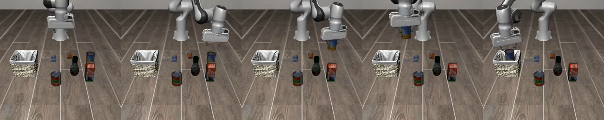
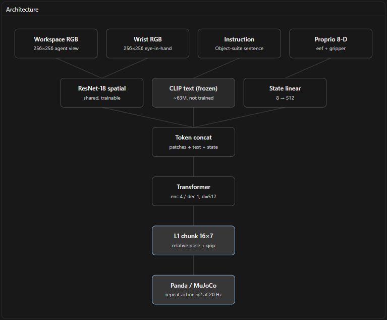

<!--
HEADLINE OPTIONS (pick one)
  1. A 7.7M-parameter robot policy, an 8 GB laptop, and a bug that cost me nine days
  2. My robot wasn't failing. My eval was.
  3. Building a tiny VLA: 91.75% on LIBERO from a gaming laptop

SUBTITLE
  Notes from building LC-ACT, a small language-conditioned action chunking transformer
  for a simulated Franka arm. What worked, what broke, and where it still falls short.

IMAGES (upload to Substack; raw links below are from the repo)
  - assets/image.png        -> rollout strip, use near the top
  - assets/architecture.png -> the OLD v0 diagram, use in the bug section (it literally says "repeat action ×2")
  - assets/console_demo.mp4 -> convert to GIF or link the README video
-->

# A 7.7M-parameter robot policy, an 8 GB laptop, and a bug that cost me nine days

*Notes from building LC-ACT, a small language-conditioned action chunking transformer for a simulated Franka arm. What worked, what broke, and where it still falls short.*

---

The first policy I trained scored 0 out of 10.

The task was "pick up the alphabet soup and place it in the basket." The arm would reach roughly the right spot, close its gripper with confidence, and then do something that wasn't quite the task. I spent the next week assuming the model was the problem. More epochs, more layers, different learning rates. Still zero.

The model was fine. My evaluation loop was executing every action twice.

I'll come back to that. First, some context on what I'm building and why it has to be small.


*A closed-loop LIBERO-Object rollout: reach, grasp, carry, release.*

## Why build a small one

My longer-running side project is [Starscream](https://github.com/gouthamk16/starscream), a simulated drone stack: Gazebo for the world, PX4 for the autopilot, ROS 2 for my own code. Right now a hand-written `HoverPolicy` decides what the drone should do. It streams a setpoint 2 m up and tells PX4 to hold it. The plan is to replace that with a learned policy that sees, reads an instruction, and acts.

Before putting a learned policy on something that flies, I wanted to understand the loop on something that doesn't fall out of the sky. So [LC-ACT](https://github.com/gouthamk16/lc-act) lives as a submodule inside Starscream. Same slot, different body:

```text
LcAct       → pose deltas         → Panda arm
HoverPolicy → TrajectorySetpoint  → PX4
```

The hardware constraint shaped everything else. I train on an RTX 4060 laptop with 8 GB of VRAM, running WSL2 with 10 GB of RAM. That rules out the models everyone talks about. OpenVLA-OFT is a 7B model and needs 25 to 62 GB. SmolVLA wants 10 to 16 GB. So instead of fine-tuning a big vision-language model, I built a small one from parts.

## The benchmark and the bar

[LIBERO](https://libero-project.github.io/) is a set of simulated tabletop tasks for a Franka Panda arm in MuJoCo. The four standard suites each have ten tasks:

- **Spatial**: same objects, different layouts ("pick up the black bowl next to the plate")
- **Object**: different objects, same layout
- **Goal**: same scene, different goals ("open the middle drawer")
- **Long**: multi-step tasks that chain the above

I train on the LeRobot version of the dataset: 1,693 human demos and 273k frames across all 40 tasks.

The reference I'm chasing is [MINERVA](https://arxiv.org/abs/2609.03715), a paper from last month titled *How Small Can a Manipulation Policy Be and Still Solve LIBERO?* Their 9.66M model averages 97.45% across the four suites. π₀.₅, a far bigger model, gets 97.5% through LeRobot. Their most striking result is that a **0.54M** policy still gets about 95%.

That last number humbled me, and I'll come back to it.

## The model: observe, chunk, act

LC-ACT has the same three boxes as any vision-language-action policy:

1. **Vision.** Two cameras, one fixed on the workspace and one on the wrist. Each image is resized to 128×128 and passed through a shared ResNet-18. I cut the ResNet after `layer3`. At 128 px that leaves an 8×8 grid of feature tokens per camera, and it drops `layer4`'s 8.4M parameters, which would have been more than the rest of the model combined.
2. **Language.** A frozen CLIP text encoder turns the instruction into a single token. LIBERO only has 40 distinct instructions, so I cache the embeddings by string and CLIP only ever encodes 40 sentences.
3. **Action.** A small transformer (width 256, 3 encoder layers, 2 decoder layers) reads all the tokens: 64 workspace, 64 wrist, 1 language, 1 robot state. Sixteen learned queries in the decoder each predict one future step. The output is a **16-step chunk** of 7-D actions: relative position, rotation, and gripper.

A few details turned out to matter more than they look:

- **Every image token gets a 2-D sinusoidal position embedding and a learned camera ID.** Without them, a transformer encoder is permutation-invariant. It has no idea which patch was top-left or whether it came from the wrist. For a task that's all about *where* things are, that's fatal.
- **The instruction modulates the image tokens through FiLM** (a learned per-channel scale and shift). I initialise the FiLM layer to zero so training starts from "language changes nothing" and learns how much it should.
- **The loss is plain L1 on z-scored actions.** No diffusion, no flow matching, no CVAE. Both OpenVLA-OFT and MINERVA found L1 regression matches diffusion and flow matching on LIBERO while training and running faster. I took them at their word.

At inference, the full model is **7.7M parameters** and takes about 7 ms per forward pass.

### Why chunks?

If a policy predicts one action at a time, small errors compound. Each slightly wrong step leaves the arm in a state the demos never visited, so the next prediction is a bit worse, and so on. Predicting a 16-step chunk makes the model commit to a coherent stretch of motion instead.

The analogy I use is reading aloud. Read one word at a time without looking ahead and your intonation goes weird. Glance at the whole sentence first and it comes out smooth.

The catch is that a chunk is open-loop. If the world changes halfway through, the chunk doesn't know.

### Temporal ensembling

The [ACT paper](https://arxiv.org/abs/2304.13705) gets around this, and I copied it directly. The policy **replans every single step**, but doesn't just execute the newest chunk. At step *t*, up to 16 earlier predictions have an opinion about what to do now: the chunk predicted at *t*, the one at *t−1*, and so on back to *t−15*. The executed action is a weighted average of all of them:

```python
def temporal_ensemble(candidates, decay, log_scales=None):
    """ACT temporal ensembling: candidates oldest first, weighted exp(-decay * i)."""
    ages = torch.arange(len(candidates), dtype=torch.float32, device=candidates[0].device)
    weights = torch.exp(-decay * ages)[:, None].expand(-1, candidates[0].shape[-1])
    if log_scales is not None:
        weights = weights * torch.exp(-torch.stack(log_scales).float())
    weights = weights / weights.sum(0)
    return (torch.stack(candidates) * weights).sum(0)
```

Think of it as asking your last 16 selves what to do and averaging their answers. It's smooth like a chunk but still reacts to every new frame. On the Object suite this alone moved success from 86% to 95%.

The `log_scales` path is newer. A small head predicts a Laplace scale (basically "how sure am I") for each action dimension, trained on detached features so it can't change the actions themselves. With `--ensemble uncertainty`, a confident new prediction can outvote an unsure old one. The idea is to help with the fine positioning right before a grasp. It's in the bench, but I haven't proven it beats the plain version yet.

## The bug: one row is one step

Back to the 0/10.

The LeRobot LIBERO dataset says it was recorded at 10 fps. My simulator runs a 20 Hz control loop. So the obvious move, and the one I made, was to repeat each predicted action twice to line up the timing.


*My original v0 diagram. Look at the last box: "repeat action ×2 at 20 Hz."*

That was wrong. The 10 fps is a metadata label, nothing more. The longest Object episode in the dataset is 254 rows, which matches openpi's 254 environment-step count exactly. **One dataset row is one control step.** By repeating each action, I was doubling every motion. The arm overshot every reach and closed the gripper on air.

The fix was one line in the eval loop. The same 3-epoch checkpoint that scored 2/10 with the repeat scored **10/10** without it. Same weights, same seeds.

I'd spent nine days tuning a model that was already working. The lesson I keep relearning: when a closed-loop policy fails completely, check the time axis and the coordinate frames before you touch the model. (There was a second one of these, by the way. LIBERO's dataset images are rotated 180° from what raw MuJoCo renders. Every eval frame has to be flipped in both H and W or the policy is looking at an upside-down world.)

## Letting an agent do the boring part

With a working eval, the next job was making the model better. I borrowed the idea behind Karpathy's [autoresearch](https://github.com/karpathy/autoresearch): write a plain-English `program.md` that describes the research loop, then let a coding agent run it overnight.

The loop is simple:

1. Edit `model.py` or `train.py` with one idea.
2. Commit.
3. Train for a fixed **10-minute** wall-clock budget.
4. Read validation L1 on a held-out split (the last 10% of every task's demos).
5. If it improved, keep the commit. If not, `git reset`.
6. Log it to a TSV and repeat. Never ask the human whether to continue.

A fixed time budget, rather than a fixed step count, matters here. A bigger model gets fewer steps in ten minutes, a smaller one gets more, and the comparison stays fair on the hardware I actually have.

Two guardrails turned out to be important:

- **Validation L1 alone can be gamed.** It's measured in z-scored units, so the model can win by getting better at the dimensions that barely move. Every run also reports **raw L1** in real units and **gripper sign accuracy** (did it open/close at the right time). A change only counts if val L1 drops *and* gripper accuracy doesn't drop by more than 0.03.
- **Architecture before knobs.** `program.md` tells the agent to prefer structural ideas (token layout, conditioning, depth, heads) over learning-rate tweaks. A 0.002 gain from doubling the LR teaches me less than a smaller gain from a cleaner design.

There's also a simplicity rule: equal results with less code is a win. That rule did most of the work. The agent shrank the model from **28.5M to 7.6M trainable parameters** (128 px input instead of 256, ResNet cut at `layer3`, transformer width halved from 512 to 256, fewer layers) while Object-suite success went *up*, from 62% to 86% before temporal ensembling.

Smaller model, better results. MINERVA says the same thing much more rigorously: small LIBERO policies are limited by vision capacity, not total size.

## Scaling to 40 tasks: the bottleneck was never the GPU

The first version only trained on the 10 Object tasks. Going to all 40 meant 4× the data, and suddenly training wasn't GPU-bound at all.

**Video decoding.** LeRobot stores frames as AV1 video. Random access into AV1 means seeking to a keyframe and decoding forward, over and over. I was getting about 220 samples/s with the GPU mostly idle.

The fix was a one-time frame cache. Decode every video once, resize to 128 px using the model's own resize filter (bit-exact against LeRobot's decoder output), and re-encode each frame as a quality-95 JPEG. The mean error is about 1/255, which is less than the AV1 compression already introduced. The whole pack is 3.6 GB, small enough to live in the OS page cache. Now a random sample costs one JPEG decode instead of a video seek: **220 → 830 samples/s.** Building it takes about 25 minutes and needs ~30 GB of scratch disk.

**Memory layout.** Running the ResNet stem in `channels_last` cut the batch-64 step from 157 ms to 70 ms on the 4060. That's a 2.2× speedup from a single flag, because Ada's fp16 convolution kernels want NHWC.

**Simulator RAM.** Each LIBERO environment holds about 2.9 GB of RAM. I went looking for a leak and found that robosuite preallocates MuJoCo's constraint arena for `njmax = nconmax = 5000`, and LIBERO genuinely uses up to 4,914 of those rows. So it can't shrink. On a 10 GB WSL box that means two parallel environments, max, and never at the same time as training.

**Rendering.** Under WSL2, EGL quietly falls back to `llvmpipe`, which is software rendering on the CPU. Switching the benchmark to GLFW with Mesa's D3D12 driver puts rendering back on the GPU. I checked that the frames match the CPU renderer to within 0.5/255 on average, so the policy doesn't notice.

None of this is research. All of it decided whether I could run an experiment in an afternoon or a weekend.

## The one new idea: predicting where the scene is going

Most of LC-ACT is a careful recombination of known pieces: ACT's chunking and ensembling, OpenVLA-OFT's L1 loss, LIBERO's spatial ResNet tokens, MINERVA's small-policy findings. There is one piece I added.

A September paper, [*Think Like a World Model, Act Like a VLA*](https://arxiv.org/abs/2609.24682), showed you can improve a 0.8B VLA by making its internal features agree with a frozen world model's features. You compute the teacher's features once, cache them, and throw the alignment head away after training. It costs nothing at inference.

I can't fit a world model on my laptop, but I can fit DINOv2-small. So:

1. Run frozen DINOv2 once over every cached frame and store the mean-pooled patch features (420 MB, ~15 minutes).
2. During training, two small heads read each camera's pooled encoder tokens and try to predict:
   - the DINOv2 feature of **this frame**, and
   - the DINOv2 feature of the frame **one chunk ahead** (15 steps later).
3. Add a cosine loss (weight 0.5) on both.

The first target is standard representation alignment, à la REPA: "see the scene the way a strong vision model does." The second one is the part I care about. A chunked policy is committing to 16 steps of motion. It should have some internal sense of what the scene will look like once those steps play out. The analogy is a chess player who doesn't just see the board but has a picture of it three moves from now.

The heads add 0.66M parameters during training and zero at inference. On the 10-minute proxy, held-out L1 improved on all four suites: **0.3300 → 0.3273**.

I'll be honest: that's a small gain. It was consistent across suites, which is why I kept it, but I haven't run the clean closed-loop ablation (same recipe, alignment off, full benchmark) that would prove how much of the final number it accounts for. A spatial variant using a 4×4 grid of DINOv2 patches tied with the pooled version and got dropped under the simplicity rule.

## Results

The final run trained for 4 hours on the laptop: 40 epochs, about 11M samples, 1.7 GB of VRAM at batch 64. I benchmarked every task in all four suites at 20 initial states each, so 800 rollouts, with LeRobot's step caps and replanning every step.

| Suite | LC-ACT 7.7M (20/task) | MINERVA 9.66M (50/task) | π₀.₅ via LeRobot |
| --- | --- | --- | --- |
| Spatial | 95.5% | 98.4% | 97.0% |
| Object | 98.0% | 99.0% | 99.0% |
| Goal | 91.0% | 98.4% | 98.0% |
| Long | 82.5% | 94.0% | 96.0% |
| **Average** | **91.75%** | **97.45%** | **97.5%** |

This doesn't beat MINERVA. On Spatial and Object I'm within 1 to 3 points. On Goal and Long the gap is 7 to 12. Also, MINERVA runs 50 rollouts per task to my 20, so my numbers have wider error bars.

And remember the 0.54M MINERVA model at ~95%. A policy 14× smaller than mine beats it. This isn't a "how small can you go" result. It's a "what does the recipe still get wrong" question.

## Where it fails

The failures cluster, which is useful:

- **Drawers.** Goal 3, "open the top drawer and put the bowl inside," succeeds 55% of the time. Goal 0, "open the middle drawer of the cabinet," 75%.
- **Long tasks.** Long 8 is at 25% and Long 7 at 70%. When step one of a two-step task goes slightly wrong, step two starts from a state the demos never visited.
- **Missed grasps with no recovery.** On small or flat objects like cream cheese and milk, the gripper sometimes closes a few millimetres off. The policy then carries nothing to the basket with total confidence and "places" it. It has never seen a demo of a failed grasp, so it has no idea what recovery looks like.

The last one is the most interesting to me. It's pure imitation learning: the model learned the *motion* of the task, not the *goal*. There's also no "done" signal in the action space. Demos just end, and the trailing frames are padded with the last action, so the policy can't tell me it thinks it's finished.

MINERVA has a sharper version of this worry. They permuted the task-ID mapping and success dropped to near chance, which suggests that on LIBERO, the instruction mostly *selects* among memorised behaviours rather than being understood. With only 40 instructions in the training set, I'd bet LC-ACT does the same. Testing that properly is on the list.

## What's next

- **Language FiLM inside every ResNet stage.** Right now the instruction only modulates tokens *after* the ResNet. MINERVA conditions its vision encoder on the task from the start. My guess is this matters most for drawers, where the instruction decides which part of the image to care about. It's stashed and not yet trained.
- **A proper ablation of the DINOv2 alignment**, closed loop, so I can say with a straight face how much it's worth.
- **A termination signal**, probably an extra output head, so the policy can say "done."
- **Eventually, the drone.** The whole point of this lab is to swap a learned policy into Starscream's `HoverPolicy` slot. The loop is the same: observe, predict a chunk, execute one step, observe again.

## What I'd tell someone starting this

1. **Make your eval correct before you make your model better.** I lost nine days to a time-axis bug and an upside-down camera. Check that one dataset row maps to one control step and that eval frames look like training frames, side by side.
2. **Your data loader is probably the bottleneck.** I got a 3.8× training speedup from a JPEG cache and 2.2× more from a memory-layout flag. Neither involved the model.
3. **Give an autonomous loop real guardrails.** A single metric gets gamed. Report the one you optimise plus the ones you actually care about, and write down a simplicity rule.
4. **Small is fine.** 7.7M parameters, 7 ms per step, trained in 4 hours on a laptop, 91.75% across all four LIBERO suites. And someone else has already shown it can go a lot smaller.

The code, the model card, and the full research log are at [github.com/gouthamk16/lc-act](https://github.com/gouthamk16/lc-act). There's also a small web console (`python -m lc_act.live`) where you type an instruction and watch the arm try it, which is the most fun way to find out what the policy doesn't understand.

If you've got ideas on the drawer tasks, or you've found a good way to teach a small policy to recover from a missed grasp, I'd love to hear them.

---

*References: Zhao et al., [ACT](https://arxiv.org/abs/2304.13705) (2023) · Kim et al., [OpenVLA-OFT](https://arxiv.org/abs/2502.19645) (2025) · Liu et al., [LIBERO](https://arxiv.org/abs/2306.03310) (2023) · Sendai et al., [MINERVA](https://arxiv.org/abs/2609.03715) (2026) · Dao et al., [Think Like a World Model, Act Like a VLA](https://arxiv.org/abs/2609.24682) (2026) · Oquab et al., DINOv2 (2023) · Yu et al., REPA (2024) · Karpathy, [autoresearch](https://github.com/karpathy/autoresearch)*
